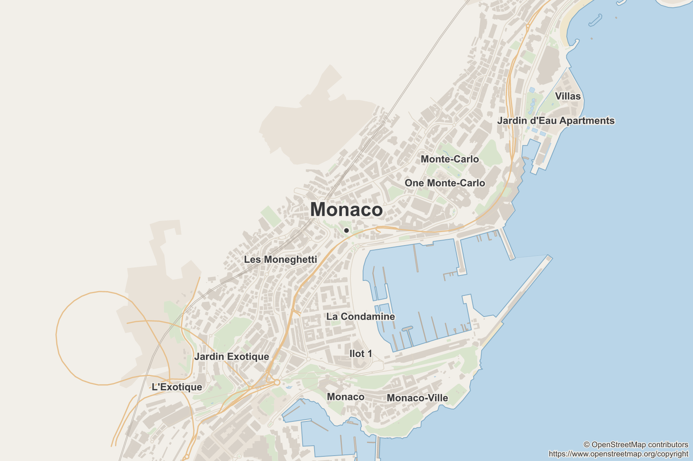

# planetrs

[](https://github.com/maeevick/planetrs/actions/workflows/ci.yml)
[](https://crates.io/crates/planetrs-geocoder)
[](https://crates.io/crates/planetrs-mapclipper)
[](LICENSE)
[](https://www.openstreetmap.org/copyright)

planetrs reads the whole of OpenStreetMap, ninety-odd gigabytes of it, so that nobody has to ask a
tile server for permission. Out of it come two things: a coordinate for a postal address that says
how far it can be trusted, and a small illustrated map of anywhere. No API, no key, no rate limit,
and no network once the planet is on disk.[^1]



## What it does, and how seriously

**It reads the planet once**, one blob at a time, and files every commune on Earth, every street,
door, hamlet and shop of France and Monaco, and every way and named place a map needs, into
GeoParquet files that DuckDB and GDAL open as they are. Two readings of one planet agree to the byte.
This is the boring part, and it was always meant to be.[^2]

**It finds the street an address meant.** Hand it an address typed in a hurry,
`ZA des Rivières - 46 Rue de Lisbonne`, or `13 Cours du Général Vauban` for a street that was always
the Maréchal's, and it comes back with the street and, when the planet knows it, the door. It does
not guess. An answer that only reached the middle of a town says so, because a town centre written
as a coordinate looks exactly like an address and is not one.

**It cuts small maps** of any box on Earth, as GeoJSON, SVG or PNG, from the dataset in a second or
two, with exactly the data a full scan of the planet would have given for that box. It has three
themes, which is modest, and every picture credits OpenStreetMap on itself, which is not optional.

One tired human, maeevick, keeps all of this running: carries the planet file between machines,
writes the tests before the code, and apologises to the laptop fan. The tests are many and strict,
mostly because nobody else is going to check.

## What is in the box

| | |
| --- | --- |
| [`planetrs-geocoder`](geocoder/README.md) | a coordinate for a place or a postal address, and how precise it is: the door, the nearest door, a shop of the label, the street, or the commune's centre |
| [`planetrs-mapclipper`](mapclipper/README.md) | a small illustrated map of anywhere, as GeoJSON, SVG or PNG, in themes that are files rather than code |

Both read a dataset built once from the OpenStreetMap planet file, from a directory or over HTTP, and
both are libraries as well as commands.

## Install

Release archives for macOS (Apple silicon and Intel) and Linux (x86_64 and aarch64, static):

```sh
target=aarch64-apple-darwin   # or x86_64-apple-darwin, x86_64-unknown-linux-musl, aarch64-unknown-linux-musl
curl -fsSL "https://github.com/maeevick/planetrs/releases/latest/download/planetrs-geocoder-$target.tar.gz" | tar -xz
install -m 755 "planetrs-geocoder-$target/planetrs-geocoder" ~/.local/bin/
```

`planetrs-mapclipper` comes the same way, or either command from crates.io with Cargo:

```sh
cargo install planetrs-geocoder-cli
cargo install planetrs-mapclipper-cli
```

`cargo install --git https://github.com/maeevick/planetrs planetrs-geocoder-cli` builds the latest
commit instead.

A binary downloaded through a browser is quarantined by macOS until `xattr -d com.apple.quarantine
planetrs-geocoder`. The binaries are not notarised yet; `curl` sidesteps the question.

## Try it on something small

Monaco is a two-square-kilometre planet that downloads in a second:

```sh
planetrs-geocoder download --from https://download.geofabrik.de/europe/monaco-latest.osm.pbf
planetrs-geocoder index --planet ~/.local/share/planetrs/planets/monaco-latest.osm.pbf --countries MC
planetrs-geocoder "Musée océanographique;Avenue Saint-Martin;98000;Monaco;Monaco"
```

```text
label;address;postal code;city;country;lat;lon;precision
Musée océanographique;Avenue Saint-Martin;98000;Monaco;Monaco;43.731809;7.427267;Street
```

The map above came out of the same file. A dataset of Monaco alone answers only for boxes inside the
principality, and this one takes in the French streets around it, so it is cut from the file itself:

```sh
planetrs-mapclipper clip --planet ~/.local/share/planetrs/planets/monaco-latest.osm.pbf \
  --lat 43.7375 --lon 7.4210 --width-km 3 --height-km 2 --width-px 900 --height-px 600 \
  --theme atlas --labels settlements --marker name --name "en=Monaco" --png monaco.png
```

The real thing is the same commands without the arguments. `download` fetches the latest planet,
about 90 GB, resumes when the connection breaks, and checks its md5 before the file takes its name,
the Monday its header states: `planet-261019.osm.pbf`, which `index` then finds on its own.
For France and Monaco, the geocoder's `index` then needs about 28 GB of memory and four minutes on a
recent laptop, after which a whole file of sites geocodes in seconds; the mapclipper's needs about
17 GB of memory, 120 GB of scratch disk and eleven minutes, after which a map of anywhere in them is
cut in a second. `index --world` files the whole planet, for a map of anywhere at all: about 33 GB of
memory, 220 GB of scratch disk and an hour and a quarter, for a map index of 225 GB in 614 tiles.

```sh
planetrs-geocoder download
planetrs-geocoder index
planetrs-geocoder -f sites.csv -o answers.csv
planetrs-mapclipper index
planetrs-mapclipper clip --lat 48.8530 --lon 2.3499 --width-km 3.5 --height-km 2 --png notre-dame.png
```

## The dataset

Both tools read a dataset rather than the planet: a directory of GeoParquet files built once from one
planet file, in `~/.local/share/planetrs/dataset` unless `--dataset` or `PLANETRS_DATASET` names
another directory or a web address.

```text
manifest.json         the planet it was built from, the licence, and each file's size and checksum
gazetteer.parquet     every administrative area of the planet, which settles a site's commune
geocoder-FR.parquet   a country's streets, doors and shops, by commune
map-summary.json      the map index as a whole: its countries or the planet, and the ground it covers
map-7-65-96.parquet   one tile of the map index: the ways, named places and multipolygons of one cell
```

`planetrs-geocoder index` writes the gazetteer and the geocoder indexes, `planetrs-mapclipper index`
the map index, each keeping the other's files when they come from the same planet. The map index is
cut into tiles of at most about a gigabyte, the cells of a quadtree over the planet, so that a map
opens only the tiles near its box. A lookup reads the communes it needs and a map the few row groups
around its box, so a dataset served over HTTP is read a few megabytes at a time, and two builds from
one planet agree to the byte.

## The workspace

```text
crates/planetrs-pbf                  reading PBF: protobuf, framing, blocks, file header, an id index
crates/planetrs-geo                  coordinates, bounding boxes, WKB, the window a block is tested against
crates/planetrs-dataset              the dataset both tools read: a manifest, a gazetteer, GeoParquet indexes
crates/planetrs-cli                  what both command lines share: data directory, outputs, progress, exit codes
geocoder/planetrs-geocoder           the geocoding library
geocoder/planetrs-geocoder-cli       the planetrs-geocoder command line
mapclipper/planetrs-mapclipper       the map library
mapclipper/planetrs-mapclipper-cli   the planetrs-mapclipper command line
```

The crates under `crates/` are shared and interpret no tag. What a `highway` means belongs to
whoever reads it.

## Why not a service

The planet file has no spatial index, so every question about it is a full scan. planetrs reads it
once, into a dataset filed by commune and by place, after which a question reads a few row groups of
it, from a disk or from wherever the dataset is published. Nothing of ours has to run in between,
which makes a command line and a library the honest shape for this rather than a hosted API.

It is also the shape the work needs. A coordinate that will be relied on after the fact has to be
defensible, and that means every step from the published planet file to the coordinate must be one
somebody else can read and re-run. Determinism against a pinned snapshot is worth more here than a
hundred metres of median accuracy, and an answer that says it is only a town centre is worth more
than one that hides it.

## Building and testing

```sh
make check          # format, lint at -D warnings, then the tests
make test-unit      # pure logic, no filesystem
make test-integrated
make test-system    # against a real planet file, PLANET=/path/to/planet.osm.pbf
make msrv doc deny package
```

Rust 1.88 or later. See [CONTRIBUTING.md](CONTRIBUTING.md) for the rest of the house rules, which
CI enforces with more enthusiasm than tact.

## Data and licence

The code is MIT, see [LICENSE](LICENSE).

The data is not ours. OpenStreetMap is © OpenStreetMap contributors and available under the Open Data
Commons Open Database License ([ODbL](https://opendatacommons.org/licenses/odbl/1-0/)) by the
OpenStreetMap Foundation (OSMF): <https://www.openstreetmap.org/copyright>. planetrs follows it for
everything it derives from the planet:

- **A dataset** built by either tool's `index` is a Derivative Database. Share one and you share it
  under the ODbL, with the notice its manifest and every one of its files carry, naming the licence
  and linking to it as data has to.
- **Geocoding results** are, under the OSMF's geocoding guideline, insubstantial extracts one at a
  time, so they bring no share-alike; wherever you show them, credit OpenStreetMap. The command line
  ends every run with that credit.
- **Maps** from `planetrs-mapclipper` are Produced Works. A picture holds no link, so each one shows
  `© OpenStreetMap contributors` and the copyright page's full address on the picture itself, and an
  SVG links it too. A GeoJSON or a kept harvest is a Derivative Database, as an index is, and names
  the licence and links to it.
- **Third-party crates** keep their own licences, and every release archive ships them in
  `THIRD-PARTY-LICENSES.html`.

[^1]: Once it is on disk. Downloading it is a few hours of somebody else's bandwidth, so the planet
    server would rather you used a mirror: `download --from` takes any of them.

[^2]: Checked rather than hoped: France and Monaco were built twice and compared file by file. The
    dataset does file communes by OpenStreetMap relation id, a compromise catalogued under
    Regrettable, Necessary.
